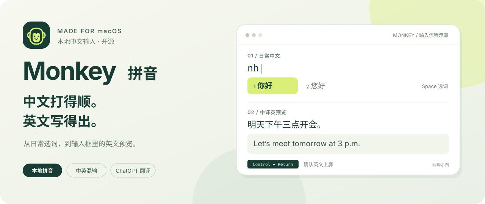
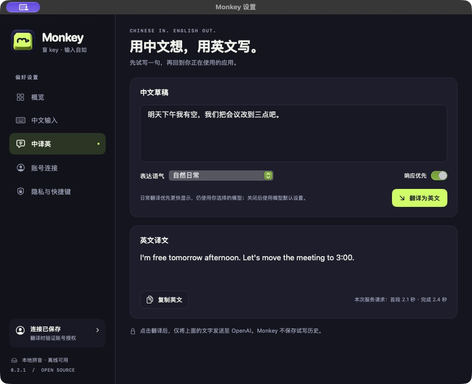

<p align="center">
  
</p>

<h1 align="center">Monkey · 盲 key</h1>

<p align="center">
  <strong>中文输入自如，英文表达随手。</strong><br>
  为 macOS 打造的开源拼音输入法：本地选词、日常混输，在输入框里预览英文。
</p>

<p align="center">
  
  
  <a href="LICENSE"></a>
</p>

<p align="center">
  <strong><a href="https://github.com/jiaqianjing/monkey/releases/download/v0.2.3/Monkey-0.2.3-macos-arm64-notarized.zip">下载 macOS 版 ↗</a></strong>
  &nbsp; · &nbsp; <a href="docs/install.md">安装指南</a>
  &nbsp; · &nbsp; <a href="https://github.com/jiaqianjing/monkey/releases">更新记录</a>
  &nbsp; · &nbsp; <a href="https://github.com/jiaqianjing/monkey/issues/new">反馈问题</a>
  &nbsp; · &nbsp; <a href="#support">请我喝杯咖啡 ☕</a>
</p>

<p align="center">
  
  <br><sub>输入流程示意。翻译由你开启，英文由你确认。</sub>
</p>

## 中文输入优先，翻译随手可用

| | Monkey 能做什么 |
| :--- | :--- |
| **熟悉的中文输入** | 基于 librime 与雾凇拼音，支持全拼、简拼、整句候选和本机用户词学习。 |
| **照顾日常混输** | 常见错拼纠正、中英词与英文候选，保留网址、邮箱和小数的 ASCII 符号。 |
| **在输入框里写英文** | 用中文组织表达，预览英文，再确认上屏。可连接 ChatGPT 账号，无需填写 API key；使用资格与额度以服务返回为准。 |

<a id="quality"></a>

试试 `nh` → 你好、`nihoa` → 你好、`upan` → U盘。混输时，先确认中文，再继续输入英文或数字。复杂同音选词与无分隔中英长串仍在打磨。[输入质量说明](docs/input-quality.md)

## 看看实际界面

原生设置与翻译试写界面，点击图片可放大。

<table>
  <tr>
    <td align="center" width="50%"><a href="docs/assets/settings-overview.png"></a><br><sub>概览 · 输入与翻译入口</sub></td>
    <td align="center" width="50%"><a href="docs/assets/settings-translation.png"></a><br><sub>中译英 · 先试写一句</sub></td>
  </tr>
</table>

<a id="download"></a>

## 下载与安装

支持 **Apple Silicon · macOS 13+**。安装器与输入法均已完成 Developer ID 签名和 Apple 公证，macOS 可能显示正常的首次下载打开确认。

1. [下载安装包](https://github.com/jiaqianjing/monkey/releases/download/v0.2.3/Monkey-0.2.3-macos-arm64-notarized.zip) 并解压，打开 **Monkey Installer.app**，点击 **安装**。
2. 从菜单栏输入法菜单选择 **Monkey 拼音**。若未出现，在 **系统设置 → 键盘 → 文字输入 → 编辑** 中添加。
3. 如需翻译，点击安装器里的 **打开 Monkey 设置**，再点击 **Continue with ChatGPT** 完成登录与授权。

更新会保留用户词库、偏好与账号连接。安装排查、下载校验和卸载方法见[安装指南](docs/install.md)。

<a id="translation"></a>

## 用中文写，确认英文上屏

1. 点击候选条里的 **中译英**，或按 `Control + Shift + T` 开启。
2. 正常用拼音选词，组成中文草稿，等待英文预览完成。
3. 按 `Control + Return` 输入英文；直接按 `Return` 使用中文原文。

```text
中文草稿   明天下午我有空，我们把会议改到三点吧。
英文预览   I’m free tomorrow afternoon. Let’s move the meeting to 3:00 p.m.
```

译文示例，具体表达与等待时间随模型和网络而变化。请求失败时保留中文草稿。候选条的齿轮可打开设置，悬浮窗随输入出现，提交或离开输入框后收起。

<a id="shortcuts"></a>

## 常用快捷键

| 操作 | 快捷键 |
| :--- | :--- |
| 选首个候选 / 按编号选词 | `Space` / 数字键 |
| 普通模式原样确认；翻译模式输入中文 | `Return` |
| 候选翻页 | `Page Up` / `Page Down` 或 `-` / `=` |
| 切换中文拼音 / 英文直输 | `Shift + Space` |
| 开关中译英 / 确认英文 | `Control + Shift + T` / `Control + Return` |
| 清除拼音 / 取消翻译请求并保留草稿 | `Esc` |

## 隐私与账号

普通中文输入和词库学习在本地完成，无需登录。开启翻译后，当前中文草稿与表达偏好会发送到 OpenAI；Monkey 不主动读取整个文档、剪贴板或 ChatGPT 聊天记录。登录凭据保存在 macOS 钥匙串中。[完整隐私说明](docs/privacy.md)

<a id="support"></a>

## 请我喝杯咖啡 ☕

Monkey 免费开源，由作者持续维护。如果它让你的中文输入或英文写作更顺手，欢迎请我喝杯咖啡，支持日常测试与体验打磨。

**[爱发电 · 支持作者 ↗](https://afdian.com/a/kenjia)**

<details>
<summary>微信、支付宝与支持渠道说明</summary>

爱发电沿用作者已有主页，目前展示为「Ken · 小喷」。这里的入口用于自愿支持作者的开源维护。

<table>
  <tr>
    <td align="center"><br>微信</td>
    <td align="center"><br>支付宝</td>
  </tr>
</table>

</details>

赞助完全自愿，所有现有功能照常免费提供。ChatGPT 订阅及服务额度由对应服务商管理，赞助不包含这些费用。点一个 Star、提交可复现的问题和分享使用建议，同样是很大的支持。

<a id="development"></a>

## 开发与致谢

[从源码构建](docs/install.md#从源码安装) · [架构说明](docs/architecture.md) · [验收记录](docs/validation.md) · [第三方声明](THIRD_PARTY_NOTICES.md)

Monkey 原创代码使用 [MIT](LICENSE)。librime、雾凇词库及其他依赖保留各自许可证，其中词库包含 GPL-3.0 数据。
